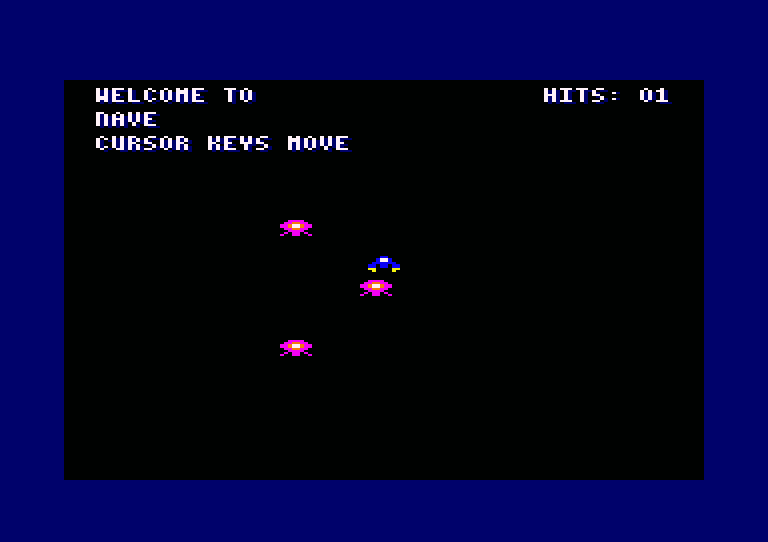

# Tu primer juego: mapa, sprites, animación y colisiones

Este recorrido parte de lo que crea `glasnost new` y lo convierte, en tres pasos,
en un juego pequeño con tu propio mapa y gráficos importados de PNG y TMX, animación
y un marcador de golpes. En cada paso el juego compila y se puede ejecutar. Tardas
unos 30 minutos.

Necesitas el SDK instalado (`glasnost doctor` debe terminar con «Todo listo») y un
emulador de CPC. Los ficheros completos de cada paso están en
[`docs/first-game/`](first-game/), y un test los aplica uno tras otro y los
compila, así que lo que lees aquí es lo que funciona. Al terminar, tu `main.s` y tu
`common.inc` serán los de `step3/` salvo por los comentarios y por el sitio exacto de
algún bloque. El juego completo, con todos sus ficheros juntos, está en
[`examples/nave`](../examples/nave/) y se compila con `make` o con `glasnost build nave`.



## Paso 0: crear el proyecto y verlo funcionar

Desde la carpeta del SDK (si `glasnost` no está en tu `PATH`, usa `bin/glasnost` o
instálalo con `bin/glasnost install-cli`):

```sh
glasnost new nave --title "mi primer juego"
cd projects/nave
glasnost build
glasnost run
```

`glasnost new` crea el proyecto en `projects/nave`, dentro del SDK. Con `--dir CARPETA`
el proyecto queda en `CARPETA/nave` (`CARPETA` es la carpeta padre). Lleva su propio
repositorio Git y ya lo ha
compilado. `glasnost build` deja en `build/nave/` los ficheros `nave.bin`,
`nave.cdt` y `nave.dsk`. `glasnost run` abre la imagen en un emulador si hay uno
instalado; si no, `glasnost run -- --print-path` te dice dónde está la imagen
para abrirla con el tuyo (en un CPC real o emulado: `RUN"NAVE`).

Verás una nave que se mueve con las flechas del cursor y tres drones que
patrullan, sobre un fondo de plataformas. Tu código es `main.s` y `common.inc`; léelos, están comentados. Todo
lo demás lo gestiona glasnost: no edites `generated/` (lo regenera `glasnost
config`; se versiona en Git, así que tras un `config` aparecerá modificado y es normal) ni `example.json` más allá de lo que se indica abajo.

Antes de tocar nada, haz una copia de seguridad en Git (o confía en que el
primer commit ya está hecho): `git status` debe salir limpio. Así puedes volver
atrás con `git checkout .` si algo sale mal.

## Paso 1: tus gráficos y tu mapa vienen de ficheros

La nave, los drones y el fondo no están escritos a mano en `main.s`: salen de
ficheros de la carpeta `assets/`, que glasnost convierte al compilar. Un sprite del
CPC en Mode 0 usa 2 píxeles por byte, así que un dibujo de 8x8 píxeles ocupa 4
bytes por 8 líneas; en vez de calcular esos bytes, dibujas un PNG. Este paso mira
cómo funciona y cambia el mapa por uno tuyo, sin tocar código.

Ficheros de este paso: [`step1/`](first-game/step1/).

1. Abre `assets/`. Esto es lo que ya trae el proyecto:

   ```
   assets/
     assets.json        qué imágenes y mapas hay y qué etiqueta recibe cada uno
     palette.json       los 16 colores del juego
     src/sprites.png    la nave y el dron (tira de 16x8 píxeles)
     src/tiles.png      el tileset del fondo (4 tiles de 8x8)
     src/level.tmx      el mapa del fondo (Tiled, 20x6 tiles)
     generated/         lo escribe la conversión al compilar: no lo edites
   ```

2. `assets/src/sprites.png` es una tira de 16x8 píxeles: la nave a la izquierda y
   el dron a la derecha. `tiles.png` sigue la misma regla. **Cada píxel debe tener
   exactamente uno de estos colores RGB**, cada uno es una pluma del CPC:

   | Pluma | RGB en el PNG |
   |---|---|
   | 0 (transparente) | 0, 0, 0 |
   | 1 | 255, 0, 255 |
   | 3 | 255, 128, 0 |
   | 6 | 255, 255, 0 |
   | 10 | 0, 0, 255 |
   | 15 | 255, 255, 255 |

   El conversor asigna cada píxel a la pluma de la paleta más parecida con su
   propia tabla de colores, así que usa estos valores exactos (están medidos con
   la herramienta real); en pantalla cada pluma se ve del color que le da
   `assets/palette.json`, no del color del PNG.

3. `assets/palette.json` define los 16 colores del juego con los números de
   tinta del firmware del CPC (0 a 26).

4. `assets/assets.json` dice qué hay y qué etiqueta recibe cada cosa:

<!-- guia: ../../templates/ecs-welcome/assets/assets.json -->
```json
{
  "version": 1,
  "palette": "palette.json",
  "palette_symbol": "game_palette",
  "images": [
    {
      "source": "src/sprites.png",
      "width": 8,
      "height": 8,
      "tiles": [
        "game_ship_pixels",
        "game_drone_pixels"
      ]
    },
    {
      "source": "src/tiles.png",
      "width": 8,
      "height": 8,
      "symbol": "game_tileset",
      "tiles": [
        "game_tile_empty",
        "game_tile_ground",
        "game_tile_wall",
        "game_tile_platform"
      ]
    }
  ],
  "tilemaps": [
    {
      "source": "src/level.tmx",
      "layer": "background",
      "symbol": "game_map",
      "compression": "zx7b"
    }
  ]
}
```

   `width` y `height` son el tamaño de cada tile o sprite en píxeles; `tiles` da el
   nombre de cada uno, de izquierda a derecha y de arriba abajo. El mapa se lee de
   la capa `background` del TMX y se guarda comprimido con ZX7B. La conversión crea
   `assets/generated/assets.s` (los bytes) y `assets.inc` (constantes como
   `GAME_PALETTE_SIZE`, `GAME_MAP_WIDTH` y `GAME_MAP_HEIGHT`), y la compilación los
   incluye sola. En `main.s`, `_main` descomprime el mapa con `fwk_zx7b_unpack` y lo
   dibuja con `fwk_tilemap_render_view`; el tamaño del mapa llega de esas constantes.

5. Cambia el mapa. **Sustituye** `assets/src/level.tmx` por
   [`step1/assets/src/level.tmx`](first-game/step1/assets/src/level.tmx) o edítalo con
   [Tiled](https://www.mapeditor.org/). Lo que importa es la capa `background`, de
   20x6 (el ancho de la pantalla, en tiles de 4 bytes; el juego la dibuja pegada al borde inferior), cuyos números son tiles de `tiles.png` contados de izquierda a derecha y de
   arriba abajo desde el 1; el 0 es vacío. Esta es la capa del fichero del paso:

<!-- guia: step1/assets/src/level.tmx -->
```xml
0,0,0,0,0,0,0,0,0,0,0,0,0,0,0,0,0,0,0,0,
0,0,0,0,0,0,0,0,0,0,0,0,0,0,0,0,0,0,0,0,
0,0,4,4,4,0,0,0,0,0,0,0,0,0,0,4,4,4,0,0,
0,0,0,0,0,0,0,0,0,0,0,0,0,0,0,0,0,0,0,0,
0,0,0,0,0,0,0,0,4,4,4,4,0,0,0,0,0,0,0,0,
3,3,3,3,3,3,3,3,3,3,3,3,3,3,3,3,3,3,3,3
```

Ejecuta `glasnost build` y `glasnost run`: el fondo tiene las plataformas nuevas y
todo lo demás se ve igual. La conversión solo se repite con lo que cambió, y un test
comprueba que los bytes de los sprites son los que saldrían de dibujarlos a mano.
Para cambiar la nave o el dron, edita `sprites.png` con las mismas reglas y vuelve a
compilar.

## Paso 2: animación

El ECS anima las entidades con el componente `animation`: cada una tiene un
descriptor con sus fotogramas y cuántas llamadas dura cada uno. Hay que activar el
componente y su módulo en `example.json`.

Ficheros de este paso: [`step2/`](first-game/step2/).

Los `main.s` y `common.inc` de `step2/` y `step3/` son completos, así que puedes copiarlos
enteros en vez de editar. Una diferencia con la plantilla: ahí la comprobación del carry
tras una llamada al framework es el macro `GAME_CHECK_OK`, desactivado por defecto; en
estos ficheros es la rutina `_game_expect_ok`, que comprueba siempre y detiene el juego
con el código de error en `game_status`. Si editas a mano, cambia cada
`call _game_expect_ok` que veas más abajo por `GAME_CHECK_OK`.

1. Dibuja los fotogramas nuevos: una tira de 32x8 con la nave, la nave con las
   llamas cambiadas, el dron y el dron con las patas cambiadas
   ([`step2/assets/src/sprites.png`](first-game/step2/assets/src/sprites.png)). **Sustituye** el PNG
   del proyecto por esta tira (mismo nombre, `assets/src/sprites.png`) y **sustituye** el array
   `tiles` de la primera imagen de `assets.json` (la de `src/sprites.png`) por el siguiente,
   que declara los cuatro:

<!-- guia: step2/assets/assets.json -->
```json
      "tiles": [
        "game_ship_pixels",
        "game_ship_pixels2",
        "game_drone_pixels",
        "game_drone_pixels2"
      ]
```

2. En `example.json`, añade el componente en `ecs.components` y el módulo en
   `modules` (antes de `extensions/behavior.s`):

<!-- guia: step2/example.json -->
```json
    "core/ecs_animation.s",
```

<!-- guia: step2/example.json -->
```json
    "components": [
      "behavior",
      "input",
      "animation"
    ]
```

3. Cambiaste el manifiesto, así que lo que glasnost genera a partir de él (el
   perfil ECS: qué campos tiene cada entidad) está desactualizado.
   `glasnost build` te lo dirá (`generated/ecs_profile.inc is stale; run glasnost
   config`); ejecuta:

   ```sh
   glasnost config
   ```

   Sin opciones, `config` regenera solo `generated/` y no toca tus ficheros.
   **Hazlo cada vez que añadas o quites un componente o un módulo del ECS.**

4. Abre `common.inc` y haz cinco cambios (el bloque de abajo los muestra en este
   orden, separados por líneas en blanco):

   - añade `.include "core/ecs_animation.inc"` justo antes de
     `.include "extensions/behavior.inc"`;
   - las dos líneas `.globl` nuevas **sustituyen** a la línea `.globl game_palette, ...`
     del proyecto;
   - `GAME_ANIM_TICKS` va justo antes del comentario `;; Spawn row`;
   - la macro `GAME_ROW` se **sustituye** entera por la nueva, que gana el campo `anim`;
   - las dos líneas `GAME_PLAYER_COMPS` y `GAME_DRONE_COMPS` se **sustituyen** por las de
     abajo (ganan `ECS_C_ANIMATION`):

<!-- guia: step2/common.inc -->
```asm
.include "core/ecs_animation.inc"

.globl game_palette, game_ship_pixels, game_ship_pixels2
.globl game_drone_pixels, game_drone_pixels2

;; Frames of an animation last this many calls of the animation system.
GAME_ANIM_TICKS = 8

;; Spawn row: components, type, x, y, width and height (bytes, lines), sprite,
;; behavior program, animation descriptor (0 = none).
.macro GAME_ROW comps, type, x, y, w, h, sprite, program, anim
    .dw comps
    .db type, x, y, w, h
    .dw sprite
    .dw program, anim
.endm

GAME_PLAYER_COMPS = ECS_C_RENDER|ECS_C_MOTION|ECS_C_INPUT|ECS_C_ANIMATION
GAME_DRONE_COMPS  = ECS_C_RENDER|ECS_C_MOTION|ECS_C_BEHAVIOR|ECS_C_ANIMATION
```

5. En `main.s`, los descriptores de animación: número de fotogramas, duración y los
   punteros a los sprites. Van en la zona de datos (`.area _DATA`), justo antes del
   comentario `;; ---- Spawn rows`:

<!-- guia: step2/main.s -->
```asm
_game_anim_ship:  .db 2, GAME_ANIM_TICKS
    .dw game_ship_pixels, game_ship_pixels2
_game_anim_drone: .db 2, GAME_ANIM_TICKS
    .dw game_drone_pixels, game_drone_pixels2
```

Y las cuatro filas `_game_row_*` se **sustituyen** por estas: cada una gana un último campo, su
descriptor (o 0 si no tiene animación):

<!-- guia: step2/main.s -->
```asm
_game_row_player: GAME_ROW GAME_PLAYER_COMPS, GAME_T_PLAYER, 38, 170, 4, 8, game_ship_pixels, 0, _game_anim_ship
_game_row_drone0: GAME_ROW GAME_DRONE_COMPS, GAME_T_DRONE, 30, 70, 4, 8, game_drone_pixels, _game_program_drone, _game_anim_drone
_game_row_drone1: GAME_ROW GAME_DRONE_COMPS, GAME_T_DRONE, 40, 100, 4, 8, game_drone_pixels, _game_program_drone, _game_anim_drone
_game_row_drone2: GAME_ROW GAME_DRONE_COMPS, GAME_T_DRONE, 30, 130, 4, 8, game_drone_pixels, _game_program_drone, _game_anim_drone
```

6. Al crear la entidad, activa su animación (`fwk_ecs_anim_set`, con `IY`
   apuntando a la entidad nueva). Primero declara, en la zona de datos y justo
   después de la línea `_game_tpl: ...`, dónde guarda `_game_spawn` el descriptor de la
   fila que está leyendo:

<!-- guia: step2/main.s -->
```asm
_game_anim:     .dw 0                  ; descriptor of the row being spawned
```

   Y en `_game_spawn`: **mantén** la línea `ld ECS_E_BEHAVIOR_PROGRAM(iy), a` y
   **sustituye todo lo que viene después**, hasta el final de la rutina (la línea
   `jp fwk_ecs_entity_create` incluida), por:

<!-- guia: step2/main.s -->
```asm
    ld a, (hl)
    inc hl
    ld ECS_E_BEHAVIOR_PROGRAM+1(iy), a
    ld e, (hl)
    inc hl
    ld d, (hl)
    ld (_game_anim), de             ; animation descriptor of this row
    ld ECS_E_RENDER_FLAGS(iy), #ECS_RENDER_VISIBLE | ECS_RENDER_DIRTY
    ld hl, #_game_tpl
    call fwk_ecs_entity_create
    ret c
    ld hl, (_game_anim)
    ld a, h
    or l
    ret z                           ; no animation
    jp fwk_ecs_anim_set             ; IY = the new entity
```

   Y en el bucle principal, justo después de `call fwk_ecs_system_motion_u8` y su
   comprobación, el sistema de animación:

<!-- guia: step2/main.s -->
```asm
    ld ix, #game_manager
    call fwk_ecs_system_animation    ; every animation counts down and changes frame
    call _game_expect_ok
```

Compila y ejecuta: la nave y los drones ahora alternan dos fotogramas. Si el juego
se queda parado nada más arrancar, mira `game_status` (variable pública de
`main.s`): vale `0x5A` cuando todo va bien, y en caso contrario el código de error
del ECS (`docs/ecs-abi-2.0.md`).

## Paso 3: colisiones y marcador

Cuando un dron toca la nave, sube un contador que se dibuja arriba a la derecha.
Usa el componente `collision` y la rutina `fwk_ecs_collide`, que compara una
entidad (la nave) con todas las que cumplan una máscara de componentes (los
drones, que son las que tienen `behavior`).

Ficheros de este paso: [`step3/`](first-game/step3/).

1. En `example.json`, otro componente y otro módulo; después ejecuta `glasnost
   config` (antes de compilar, como en el paso 2):

<!-- guia: step3/example.json -->
```json
    "core/ecs_collision.s",
```

<!-- guia: step3/example.json -->
```json
    "components": [
      "behavior",
      "input",
      "animation",
      "collision"
    ]
```

2. Abre `common.inc` y haz cuatro cambios (el bloque de abajo los muestra en este
   orden):

   - añade `.include "core/ecs_collision.inc"` justo después de
     `.include "core/ecs_animation.inc"`;
   - la línea `.globl cpct_setPalette_asm` **pasa a ser** la de abajo (declara también
     `cpct_drawSolidBox_asm`);
   - las dos líneas `GAME_PLAYER_COMPS` y `GAME_DRONE_COMPS` se **sustituyen** (ganan
     `ECS_C_COLLISION`);
   - el canal de contacto y el sitio del marcador van justo antes del comentario
     `;; Frames of an animation last`:

<!-- guia: step3/common.inc -->
```asm
.include "core/ecs_collision.inc"

.globl cpct_setPalette_asm, cpct_drawSolidBox_asm

GAME_PLAYER_COMPS = ECS_C_RENDER|ECS_C_MOTION|ECS_C_INPUT|ECS_C_ANIMATION|ECS_C_COLLISION
GAME_DRONE_COMPS  = ECS_C_RENDER|ECS_C_MOTION|ECS_C_BEHAVIOR|ECS_C_ANIMATION|ECS_C_COLLISION

;; Contact channel of the player against the drones. Each channel remembers by
;; itself whether the player was touching, so a hit counts once per touch.
GAME_CH_DRONE = 0x01

;; Score: where it is drawn (byte column, scanline) and its size (bytes, lines).
GAME_HUD_X = 60
GAME_HUD_Y = 4
GAME_HUD_W = 16
GAME_HUD_H = 9
```

   Cada **canal** recuerda por su cuenta si la nave ya estaba tocando algo, de modo
   que el golpe se cuenta cuando el contacto empieza y no en cada fotograma.

3. En `main.s`, tres datos nuevos: el contador (público, para poder verlo en el
   depurador), si el marcador hay que redibujarlo y el texto. Van en `.area _DATA`:
   las dos primeras líneas justo después de `game_player::`, y el texto justo después de
   `_game_str_help`:

<!-- guia: step3/main.s -->
```asm
game_hits::    .db 0              ; times a drone touched the player
_game_hud_dirty: .db 1            ; the score must be redrawn
```

<!-- guia: step3/main.s -->
```asm
_game_str_hits:    .asciz "HITS: 00"      ; the two digits are patched in place
```

4. Ahora la función que se llama en cada contacto. Va en la zona de código
   (`.area _CODE`), justo antes del comentario `;; Steering system`. Recibe en `A` si el
   contacto empieza (`ENTER`), continúa (`STAY`) o termina (`EXIT`):

<!-- guia: step3/main.s -->
```asm
_game_drone_cb:
    cp #ECS_COLLISION_ENTER
    jr nz, _game_drone_cb_done      ; STAY and EXIT do not count
    ld a, (game_hits)
    cp #99
    jr z, _game_drone_cb_done       ; the score has two digits
    inc a
    ld (game_hits), a
    ld a, #1
    ld (_game_hud_dirty), a         ; ask _game_hud_update to redraw
_game_drone_cb_done:
    xor a                           ; carry clear, A=0: keep going
    ret
```

5. Y el marcador, justo debajo de la función anterior (también en `.area _CODE`): cambia
   las dos cifras del texto, borra la caja con `cpct_drawSolidBox_asm` y dibuja el texto.
   Solo se redibuja cuando cambió:

<!-- guia: step3/main.s -->
```asm
_game_hud_update:
    ld a, (_game_hud_dirty)
    or a
    ret z                           ; nothing changed
    xor a
    ld (_game_hud_dirty), a
    ld a, (game_hits)
    ld b, #'0'                      ; B = tens digit, counted up by subtracting 10
_game_hud_tens:
    cp #10
    jr c, _game_hud_units
    sub #10
    inc b
    jr _game_hud_tens
_game_hud_units:
    add a, #'0'                     ; A = units digit
    ld (_game_str_hits + 7), a      ; "HITS: 00": units at offset 7, tens at offset 6
    ld a, b
    ld (_game_str_hits + 6), a
    ld hl, #GAME_HUD_Y
    ld c, #GAME_HUD_X
    call fwk_video_get_ptr
    ex de, hl
    ld b, #GAME_HUD_H
    ld c, #GAME_HUD_W
    xor a
    call cpct_drawSolidBox_asm       ; black box over the old digits
    ld hl, #GAME_HUD_Y
    ld c, #GAME_HUD_X
    call fwk_video_get_ptr
    ld iy, #_game_str_hits
    jp fwk_text_draw
```

6. En el bucle principal (`game_frame`), después de la llamada al sistema de recorte
   (`call fwk_ecs_system_run` con `#_game_clamp` y su `call _game_expect_ok`) y antes del
   comentario `;; Selective render`, la comparación de la nave con los drones:

<!-- guia: step3/main.s -->
```asm
    ld ix, #game_manager             ; the player against every drone (collision + behavior)
    ld iy, (game_player)
    ld bc, #ECS_C_COLLISION | ECS_C_BEHAVIOR
    ld hl, #_game_drone_cb
    ld e, #GAME_CH_DRONE
    call fwk_ecs_collide
    call _game_expect_ok
```

Y al final del bucle, justo antes de `jp game_frame`, el marcador:

<!-- guia: step3/main.s -->
```asm
    call _game_hud_update            ; after the render: text goes over what it left
    jp game_frame
```

Compila y juega: cada vez que un dron te toca, `HITS` sube en uno. Mantenerte
encima del dron no lo sube más; sepárate y vuelve a tocarlo y sube otra vez. Este
es el juego de la captura de arriba.

## Dónde seguir

- **Entender el código terminado**: [`nave-walkthrough.md`](nave-walkthrough.md) recorre
  `examples/nave` rutina por rutina, con el contrato de cada una y dos ejercicios.
- **Más sistemas del ECS**: el mismo patrón sirve para todos. Añade el componente y
  el módulo a `example.json`, ejecuta `glasnost config`, y declara las etiquetas y
  constantes en `common.inc`. Mira `examples/platformer` (física de plataformas,
  mapas de tiles, HUD) y `docs/platform-game-guide.html`.
- **Mapas de tiles**: `assets.json` también convierte mapas de Tiled (`tilemaps`); el
  ejemplo `platformer` tiene dos niveles.
- **Sonido**: `docs/audio-akg.md`.
- **Más memoria**: `glasnost config --extended-memory` (CPC 6128, 128 KB).
- **Actualizar el SDK**: `glasnost projects` y `glasnost update` migran tus
  proyectos a la versión nueva en una rama de Git, con vuelta atrás con
  `glasnost rollback`.

## Si algo falla

- **«generated/ecs_profile.inc is stale»**: has cambiado `example.json`. Ejecuta
  `glasnost config`.
- **La conversión del PNG falla**: algún píxel usa un color que no está en la paleta.
- **Un símbolo no definido al enlazar**: falta su `.globl` en `common.inc` o su
  nombre en `tiles` de `assets.json`.
- **El juego arranca pero no se mueve nada**: lee `game_status` (arriba) en el
  depurador del emulador.
- **Quieres empezar de nuevo**: `git checkout .` en el proyecto, o crea otro con
  `glasnost new`.
